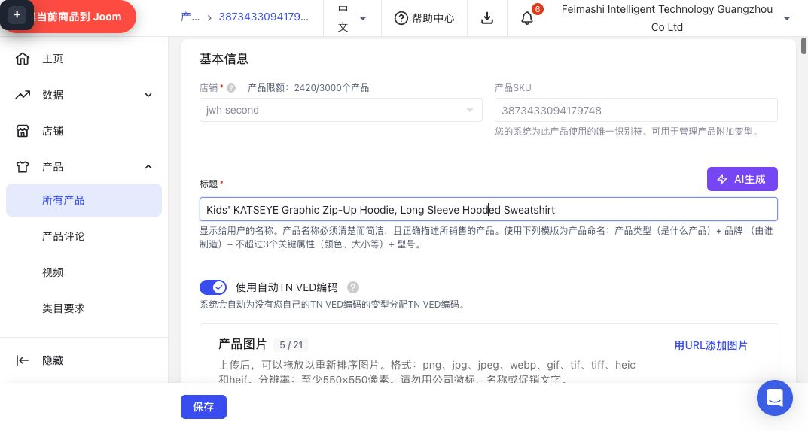
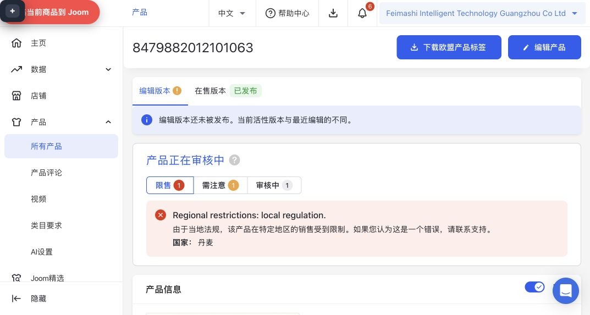
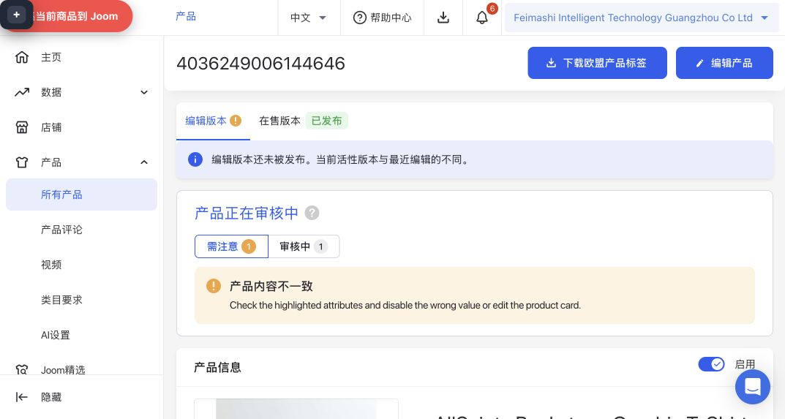

# Joom 国家、类目与商品优化

记录时间：2026-11-26T11:03:53.198073+08:00。本次仅Joom，使用ChatGPT自带Chrome浏览器工具。

## 国家表现

近7天为2026-11-18—11-24，沿用今天10:30已读取的国家快照；近28天为10-28—11-24，本次重新读取。国家报表更新时间11-25 12:38:28。每家店仅13个可见国家，三店按国家加总；不能称为全部目的国排名，未显示国家也不能当0。转化率=加总购买次数÷加总点击。

| 国家 | 7天点击 | 7天购买 | 7天GMV美元 | 7天转化 | 28天购买 | 28天转化 |
| --- | ---: | ---: | ---: | ---: | ---: | ---: |
| 英国 | 272 | 29 | $156.41 | 10.66% | 75 | 9.43% |
| 德国 | 336 | 20 | $139.37 | 5.95% | 44 | 4.59% |
| 瑞典 | 145 | 8 | $39.97 | 5.52% | 23 | 6.41% |
| 荷兰 | 106 | 9 | $42.44 | 8.49% | 17 | 5.00% |
| 法国 | 190 | 9 | $76.93 | 4.74% | 19 | 3.14% |
| 波兰 | 152 | 8 | $67.91 | 5.26% | 15 | 3.72% |
| 俄罗斯 | 168 | 0 | $0.00 | 0.00% | 3 | 0.45% |
| 乌兹别克斯坦 | 130 | 1 | $9.99 | 0.77% | 2 | 0.27% |

建议：英国、德国优先，瑞典、荷兰次优先；英国在两个窗口都兼具较高购买和转化。俄罗斯、乌兹别克斯坦先检查具体商品可售、配送费用及承诺时效，再决定投放去留。爱尔兰28天10次购买、129次点击，但不在7天可见集合，不能把7天算成0。国家强不代表每款商品可售，例如本次KATSEYE在英国等地区存在版权限售。

本次未取得国家×实物子类目交叉表，不声称某一类目在某一国家已经验证最好；也不把转化或GMV当净利润。

## 类目表现

按后台根类目筛选本次读取，窗口与国家相同；顶部卡片未随筛选更新，仅采用对应筛选后的表格总数。分类沿用卖家已有数据，根类目含配饰，不能等同纯T恤、纯卫衣销量。

| 后台根类目 | 7天购买 | 7天GMV美元 | 7天转化 | 28天购买 | 28天GMV美元 | 28天转化 |
| --- | ---: | ---: | ---: | ---: | ---: | ---: |
| 中性服装及配饰 | 74 | $340.11 | 6.32% | 195 | $875.11 | 4.83% |
| 母婴与童装 | 52 | $506.65 | 3.82% | 114 | $1074.29 | 2.97% |
| 运动及娱乐 | 1 | $5.00 | 2.08% | 2 | $9.50 | 1.41% |
| 女装及配饰 | 2 | $7.96 | 3.03% | 6 | $23.88 | 3.23% |

中性服装成交量与转化领先，近7天购买较前7天+51.02%；童装销售额更高，购买+79.31%，但转化低于中性服装，优先核查尺码、款式描述和配送总价。运动/女装样本太少，暂不足以大举扩展。男装根类目无匹配行，不代表男装没需求，男款可能归在中性服装。叶级T恤筛选未返回可验证结果，不能将其作为零销售结论。

## 已执行商品优化

从10-29—11-25的默认按购买排序前500款中挑选本期0购买、有点击加购的三款；不是历史0订单，也不是全量高点击排名。销量领先的Gothic、CR7、NBHD等保留；已知短袖/卫衣冲突商品6aad547abaf5a401f56aeddf近28天已有7次购买，本轮按用户保护高销量偏好未改。

| 商品尾号 | 28天点击 | 加购 | 购买 | 实际修改 |
| --- | ---: | ---: | ---: | --- |
| [44aea](https://merchant.joom.com/panel/products/6af2725f91f35a019a244aea) | 15 | 5 | 0 | 精简标题、补搜索标签，描述圆领改连帽、儿童毛衣改拉链卫衣；仅此款按用户确认100%棉，将结构化材质规范为cotton 100%，删除重复材质行以消除保存校验冲突。 |
| [4246a](https://merchant.joom.com/panel/products/6af26eae91f35a019a24246a) | 23 | 9 | 0 | 精简标题、补搜索标签，描述圆领改连帽、儿童毛衣改套头卫衣；保留原结构化cotton，删除未经用户确认且与旧字段冲突的100%描述，未新增材质比例。 |
| [b1f87](https://merchant.joom.com/panel/products/6aefe7607da39a01738b1f87) | 18 | 8 | 0 | 标题明确短袖、背部印花与深灰色；补搜索标签，分行整理描述，清除不适用的皮革标签及无装饰模板文字；保留原棉材质类型及全部尺码数值。后台仍提示产品内容不一致，具体高亮冲突未定位清楚。 |

三款均已保存到编辑版本并显示审核中，尚未确认在售版本更新。价格、库存、规格、运输尺寸重量等变型信息保存前后核对一致；KATSEYE35个规格、AllSaints8个规格用重开编辑表单核对，Huntrix用保存前后详情页全部变型区域文本核对。

剩余问题：KATSEYE英国等地区版权限售及丹麦当地法规限制仍存在；Huntrix丹麦法规限售仍存在。AllSaints后台仍提示产品内容不一致，尚未明确具体高亮冲突，因此不声称三款所有问题已经消除。应通过平台确认/复核真实属性及限制，不通过改名规避限售。本次未提交申诉。

## 观察安排

本次没有增加预算、没有调整竞价。先核验实际发布，生效后3天观察曝光点击、7天看点击到加购和成交、14天看归因回补与售后；低流量样本继续观察，不把短期变化认定为文案修改因果。没有国家/单款利润证据，不直接全店扩预算。

已为三款建立独立稳定编号的观察事件，保存日不当生效日；定时任务只读取并建议，不扩展成自动改商品授权。

## 证据

[原始与结构化快照](采集与执行快照.json)。[今天此前的店铺快照](../../../快照/店铺经营/2026-11-26/103207.json)。

